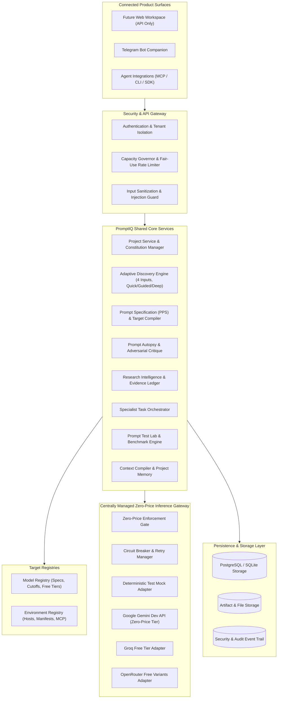

# PromptIQ System Architecture Specification

## 1. Executive Architectural Overview

PromptIQ is engineered as a **modular monolith** with clean, decoupled domain boundaries, typed data contracts, and a shared intelligence core.

### Non-Negotiable Invariants Reflected in Architecture
1. **Strictly No Website Frontend**: The system exposes robust, versioned REST APIs and OpenAPI schemas. No web UI, components, or client-side assets are generated.
2. **Zero-Price to User & Zero BYOK**: No user API keys or personal inference accounts. A centrally managed, operator-funded inference gateway routes requests strictly through verified zero-price tiers with comprehensive fair-use capacity governance.
3. **No Local Inference Requirement**: Users interact via cloud-hosted surfaces without needing local models, Ollama, or local GPUs.
4. **Three Connected Product Surfaces**: Web API, Telegram Bot, and Agent Integrations (MCP/CLI/SDK) interact through a single unified project memory and domain layer.

---

## 2. Subsystem Architecture

### 2.1 Identity, Workspace, and Tenant Isolation
- **Multi-Tenancy**: Every project belongs to a `Workspace`, owned by a `User`.
- **Row-Level Enforcement**: All queries filter by `workspace_id` and `user_id`. Cross-tenant retrieval is blocked at the service boundary.
- **Surface Linking**: Telegram users link their chat ID via short-lived signed HMAC tokens issued by the API.

### 2.2 Project Constitution & Provenance Engine
- **Canonical Truth**: The `ProjectConstitution` is the authoritative definition of project goals, features, UX requirements, architecture, and acceptance criteria.
- **Strict Provenance**: Every requirement and fact carries a classification:
  - `user_provided`: Explicitly supplied by user.
  - `file_extracted`: Parsed from uploaded documents/code.
  - `connected_source`: Retrieved from repository/tool.
  - `inferred`: Proposed by PromptIQ (requires user approval).
  - `research_backed`: Sourced from external verified evidence.
  - `unknown`: Explicit gap to be resolved.
  - `conflicting`: Multiple incompatible statements identified.
- **Immutability & Diffs**: Editing the Constitution creates a new immutable `ConstitutionVersion` with an automated diff and impact calculation.

### 2.3 Adaptive Discovery Pipeline
- **Initial Intake**: 4 foundational inputs:
  1. Goal / Outcome
  2. Output Deliverable (Prompt only, Prompt suite, Complete package, Recommend)
  3. Target Environment (Specific target, Multiple targets, Recommend, Undecided)
  4. Context Source (Text, Prompt, Files, URLs, Repository)
- **Discovery Depths**:
  - `Quick`: Only blocking questions.
  - `Guided`: Progressive discovery by task category.
  - `Deep`: Exhaustive 11-stage discovery (Stages A through K for software projects).
- **Anti-Fatigue Guard**: Never prompts for information already present in conversation context or uploaded files.

### 2.4 PromptIQ Prompt Specification (PPS) & Target Compilers
- **Intermediate Representation**: Decoupled Pydantic model capturing intent, audience, requirements, constraints, tool permissions, workflow stages, and output contracts.
- **Compiler Targets**:
  - `Google Antigravity`: Native plugin package (`plugin.json`, `skills/`, `rules/`, `agents/`, `hooks/`).
  - `Claude Code`: CLAUDE.md instruction hierarchy and rules.
  - `OpenAI Codex`: Plugin manifest, skills, and configuration.
  - `Cursor`: `.cursorrules` and MCP tool specifications.
  - `Gemini CLI`: Extension package and context configuration.
  - `Portable Suite / Raw Prompt`: Clean markdown instructions.

### 2.5 Prompt Autopsy & Adversarial Critique
- Multi-dimensional analysis evaluating:
  - Ambiguity & Vagueness
  - Missing Requirements & Gaps
  - Contradictions & Priority Clashes
  - Target Incompatibility (unsupported tools, context window overflow)
  - Security & Injection Vulnerabilities
  - Output Contract Completeness
- Produces structured `CriticFinding` records with:
  - Severity: `CRITICAL`, `HIGH`, `MEDIUM`, `LOW`, `INFO`
  - Evidence: Exact requirement ID or passage locator
  - Impact: Likely execution failure mode
  - Remediation: Precise, actionable fix

### 2.6 Research Intelligence & Evidence Ledger
- Research modes: `Quick Verification`, `Decision Research`, `Deep Research`, `Benchmark/Landscape`.
- **Evidence Ledger**: All claims are registered in an immutable ledger tracking:
  - `claim_id`: Unique identifier
  - `source_url`: Real opened URL
  - `publisher`: Organization or authority
  - `retrieval_date` & `publication_date`
  - `locator`: Exact heading, paragraph, or code reference
  - `support_status`: `VERIFIED`, `CONTRADICTED`, `INFERRED`, `STALE`
- Primary sources prioritized; vendor marketing separated from independent benchmarks.

### 2.7 Centrally Managed Zero-Price Inference Gateway
- **Hard Eligibility Gate**:
  - Rejects any route or model requiring user-side billing, user API keys, or nonzero pricing.
  - Routes requests through operator-curated zero-price endpoints (Gemini Developer API, Groq Free Tier, OpenRouter $0 models).
- **Capacity Governor**:
  - Per-user token and request fair-use rate limiting.
  - Pooled organization quota tracking.
  - Concurrency caps and graceful request queueing.
  - Circuit breaker: pauses requests on upstream outage instead of attempting paid fallback.
- **Deterministic Test Mode**: Mocks all provider interactions during unit and integration test runs to ensure 100% reproducible, zero-cost CI.

### 2.8 Project Memory & Context Continuity
- Keeps canonical truth outside transient LLM chat context.
- **Context Compiler**: Selects and prioritizes requirements, active decisions, and relevant evidence to pack into target token windows efficiently.
- **Checkpoints**: Records verified state transitions, open blockers, and next steps for zero-loss handoffs between agents and surfaces.

### 2.9 Connected Client Implementations
- **Telegram Bot**: Async client using official Telegram Bot API for conversation, inline menus, intake, approvals, and job notifications.
- **MCP Server**: Standard JSON-RPC server implementing Model Context Protocol tools (`forge.create_project`, `forge.run_discovery`, `forge.compile_prompt`, `forge.research`, etc.).
- **CLI & SDK**: Developer tooling for command-line compilation and programmatic integration.
