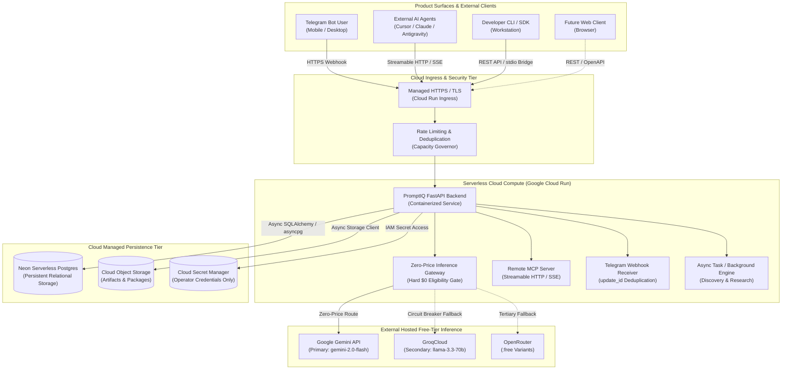

# PromptIQ Cloud-Native Production Architecture

**Status**: PRODUCTION-READY DESIGN & SPECIFICATION  
**Core Invariant**: **PROMPTIQ RUNS IN THE CLOUD, NOT ON THE LAPTOP**. The development laptop is an editing workstation only. Production operation continues 24/7 independently of whether the laptop is turned on, shut down, disconnected, or traveling.

---

## 1. Architectural Topology

---

## 2. Subsystem Architecture

### 2.1 Hosted Backend (Google Cloud Run)
- **Deployment Model**: Containerized Python 3.11 service packaged via multi-stage Dockerfile.
- **Scale-to-Zero (`minScale: 0`)**: Scales to zero instances when no traffic is present, incurring **₹0 / $0.00** idle hosting cost.
- **Autoscaling (`maxScale: 5`)**: Automatically provisions instances under load up to a configured threshold.
- **Free-Tier Limits**: Accommodated within Google Cloud Run's monthly free allocation (2,000,000 requests, 180,000 vCPU-seconds, 360,000 GiB-seconds).

### 2.2 Managed Relational Database (Neon Serverless Postgres)
- **Engine**: PostgreSQL 16 compatible with asyncpg and SQLAlchemy 2.0.
- **Persistence Guarantee**: 1 GB storage included free without artificial expiration (unlike Render's free database which deletes all data after 30 days).
- **Auto-Suspend**: Compute automatically scales to zero after 5 minutes of inactivity, consuming 0 compute hours when idle and resuming in 300–500ms on first incoming query.
- **Database Migrations**: Managed via Alembic (`alembic/`), running transactional migrations before traffic cutover.

### 2.3 Remote Model Context Protocol (MCP) Service
- **Transport**: Implements the official Model Context Protocol 2024-11-05 standard over Streamable HTTP and Server-Sent Events (SSE) via `/api/v1/mcp/sse` and `/api/v1/mcp/messages`, along with a stateless `/api/v1/mcp/rpc` endpoint.
- **Client Bridge**: Workstation tools connect using `promptiq.mcp.client_bridge`, translating local stdio calls to remote cloud HTTPS endpoints without storing state on the laptop.

### 2.4 Centrally Hosted Telegram Companion
- **Webhook Architecture**: Receives Telegram Bot updates via public HTTPS endpoint (`/api/v1/telegram/webhook`).
- **Timing-Attack Resistant Secret Verification**: Verifies `X-Telegram-Bot-Api-Secret-Token` using `secrets.compare_digest`.
- **Update Deduplication**: Maintains a 10-minute sliding window cache of processed `update_id`s, rejecting duplicate deliveries caused by network retries.
- **Conversational Continuity**: Routes free-text chat replies directly into pending discovery interview sessions without requiring slash commands.

### 2.5 Centrally Managed Inference Gateway
- **Strict Invariants**:
  - Zero-price route verification (`route_cost == 0.0`).
  - Prohibited BYOK (recursive rejection of user-supplied API keys).
  - Central server-side operator credentials stored in Cloud Secret Manager.
  - Fail-closed circuit breaker on capacity exhaustion.
