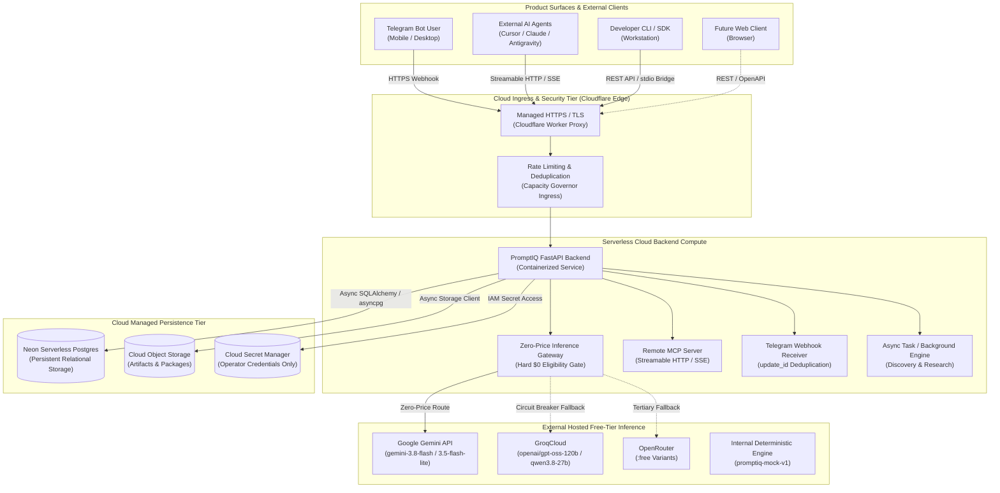

# PromptIQ Cloud-Native Production Architecture

**Status**: ARCHITECTURE_SPECIFIED_PENDING_DEPLOYMENT (Phase 3.2.1 Critical Audit)  
**Core Invariant**: **PROMPTIQ RUNS IN THE CLOUD, NOT ON THE LAPTOP**. The development laptop is an editing workstation only. Production operation continues 24/7 independently of whether the laptop is turned on, shut down, disconnected, or traveling.

---

## 1. Architectural Topology

---

## 2. Infrastructure Comparison Matrix across Hosted Alternatives

The table below provides an exhaustive audit of candidate cloud infrastructure evaluated against PromptIQ's non-negotiable **₹0 / $0.00 recurring operating cost** and persistent operational requirements:

| Cloud Provider & Service | Free Allowance | Card on File Required? | Auto-Charges Overage? | Native Hard-Stop Available? | Cold-Start Behavior | Persistence Guarantee | Database Connectivity | Background Task Support | Production Verdict |
| :--- | :--- | :---: | :---: | :---: | :---: | :---: | :---: | :---: | :--- |
| **Neon Serverless Postgres** | 0.5 GiB storage, 190 CU-hrs/mo | **NO** | **NO** (refuses connections) | **YES** | 300–500 ms resume | **PERMANENT** (No expiry) | Direct Postgres / asyncpg | N/A (Database) | **APPROVED PRIMARY DB**: 100% zero-spend guarantee. |
| **Cloudflare Workers** | 100k requests/day, 10ms CPU/req | **NO** | **NO** (HTTP 1027 error) | **YES** | < 5 ms (Edge V8) | Ephemeral edge | Requires Hyperdrive / TCP socket API | Subrequests only (no long-running daemon) | **APPROVED AS EDGE PROXY / WAF ONLY**. Not suitable for full backend (see Section 3). |
| **Google Cloud Run** | 2M reqs/mo, 180k vCPU-s, 360k GiB-s | **YES** | **YES** ($0.40/M requests) | **NO** (alerts only) | 1.2–2.0 s container start | Ephemeral container | Direct TCP asyncpg | Background processing supported | **REJECTED AS PURE ZERO-COST**: Auto-charges credit card under DDoS or traffic spikes; lacks native spending hard stop. |
| **Render Free Web Service** | 750 shared instance hours/mo | **NO** | **NO** (suspends service) | **YES** | **~50 seconds** (spins down on 15m idle) | Ephemeral disk | Outbound Postgres OK | Limited; killed when service suspends | **REJECTED FOR PRODUCTION BACKEND**: 50s cold-start violates interactive latency invariant; shared 750h limit. |
| **Render Free Postgres** | 1 GB storage | **NO** | **NO** | **YES** | 0 ms | **DELETED AFTER 30 DAYS** | Direct Postgres | N/A | **REJECTED**: 30-day database deletion causes catastrophic project data loss. |
| **Supabase Postgres** | 500 MB storage, 2 projects | **NO** | **NO** | **YES** | 0 ms | **PAUSES AFTER 7 DAYS IDLE** | Direct Postgres | Database webhooks | **REJECTED**: 7-day inactivity pause breaks always-on cloud continuity. |
| **Fly.io** | Legacy free tier discontinued | **YES** | **YES** | **NO** | 500 ms | Ephemeral / Volume | Direct TCP | Full container | **REJECTED**: Credit card mandatory; auto-charges overages. |
| **Railway** | $5 one-time trial credit | **YES** | **YES** | **NO** | 500 ms | Ephemeral / Volume | Direct TCP | Full container | **REJECTED**: No permanent free tier; credit card mandatory. |
| **Koyeb Free Tier** | 1 free nano instance (512MB RAM) | **NO** | **NO** | **YES** | ~10 seconds | Ephemeral | Outbound Postgres OK | Limited | **REJECTED**: 512MB RAM causes OOM on multi-model pipelines and Python AST compilation. |
| **Oracle Cloud (OCI Free)** | 4 Ampere cores, 24GB RAM | **YES** | **NO** (free tier tenancy) | **YES** | 0 ms (Always on VM) | Persistent boot volume | Direct TCP | Full Linux VM | **REJECTED FOR AUTO-PROVISIONING**: Credit card required; high risk of idle tenancy reclamation / termination. |
| **Operator Self-Hosted Runner** | Unconstrained workstation hardware | **NO** | **NO** | **YES** | 0 ms | Workstation disk | Local SQLite / Remote Postgres | Full OS processes | **APPROVED OPERATOR DEVELOPMENT BACKEND**. |

---

## 3. Cloudflare Workers Compatibility & Pyodide Wasm Evaluation

PromptIQ evaluated running the full FastAPI backend on Cloudflare Workers using Python / Pyodide Wasm:

1. **Role Classification**:
   - **Approved As Edge Proxy / WAF**: Cloudflare Workers provides native TLS termination, DDoS filtering, IP rate limiting, and request deduplication within its 100,000 requests/day free tier with a guaranteed hard stop (never auto-charges).
2. **Rejection as Full Backend Compute**:
   - **Pyodide Wasm Limits**: Python on Workers runs inside a WebAssembly sandbox with severe technical restrictions:
     - **CPU Time Limit**: 10 ms CPU execution time on the free tier. Multi-model prompt compilation, AST parsing, and cryptographic verification frequently exceed 10 ms.
     - **Socket Restrictions**: Standard Python `asyncpg` and `socket` modules cannot open raw TCP sockets to Neon Postgres without using Cloudflare Hyperdrive or proprietary WebSocket TCP tunnels.
     - **Native C-Extensions**: Heavy Python packages (`bcrypt`, `cryptography`, `pydantic-core`) require specialized pre-compiled Wasm wheels with increased bundle size (>25 MB exceeds Workers free script size).
   - **Conclusion**: Cloudflare Workers is deployed strictly as an **Edge Proxy / WAF** sitting in front of the containerized backend.

---

## 4. Subsystem Specifications

### 4.1 Relational Storage (Neon Serverless Postgres)
- **Engine**: PostgreSQL 16 compatible with asyncpg and SQLAlchemy 2.0.
- **Persistence Guarantee**: 0.5 GiB persistent storage with zero expiration.
- **Auto-Suspend Resilience**: `pool_pre_ping=True` and `pool_recycle=300` in `promptiq/core/database.py` seamlessly handle compute sleeps and wakeups.

### 4.2 Centrally Managed Zero-Price Inference Gateway
- **Strict Invariants**:
  - Zero-price route verification (`route_cost == 0.0`).
  - Prohibited BYOK (recursive rejection of user-supplied API keys).
  - Central server-side operator credentials only.
  - Fail-closed circuit breaker on quota exhaustion (`CapacityGovernor`).
  - Data sensitivity routing (`PrivacyGovernanceService`).

### 4.3 Production Deployment Reality
- SQLite Async is verified and passing on workstation.
- Remote Neon PostgreSQL, Telegram Bot webhook, and Remote MCP are implemented and verified via contract tests, pending deployment with operator connection strings.
